# Plotzilla

Unleash your plot on the world.

A screenwriting app for Linux that formats scripts to the Hollywood standard as you type.
It saves plain-text Fountain files, imports and exports Final Draft, and prints
industry-standard PDFs.

Plotzilla is built with Go and [Wails](https://wails.io) (GTK 3 and WebKitGTK), with a
[ProseMirror](https://prosemirror.net) editor. It has a GNOME look but is not tied to
GNOME: it runs on any Linux desktop (KDE Plasma, Xfce, Cinnamon, MATE…), on Wayland or X11, and
follows the desktop's window button layout and light/dark preference.

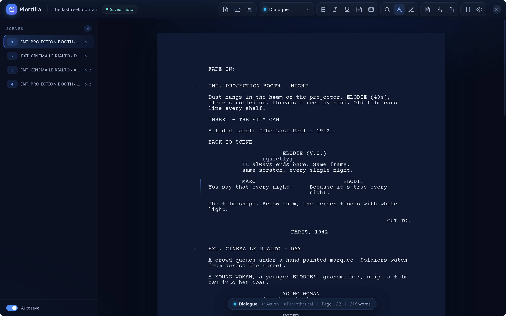

## Contents

- [Installation](#installation)
- [The editor](#the-editor)
- [Screenplay elements](#screenplay-elements)
- [Typing a script](#typing-a-script)
- [Outline and notes](#outline-and-notes)
- [Autocomplete](#autocomplete)
- [Find and replace](#find-and-replace)
- [Spelling](#spelling)
- [Translating from French](#translating-from-french)
- [Pages and scenes](#pages-and-scenes)
- [Revisions and locked pages](#revisions-and-locked-pages)
- [Title page](#title-page)
- [Saving and files](#saving-and-files)
- [Exporting](#exporting)
- [Keyboard shortcuts](#keyboard-shortcuts)
- [Desktop integration](#desktop-integration)
- [Development](#development)
- [Not supported yet](#not-supported-yet)
- [License](#license)

## Installation

Requirements (Arch Linux package names): `go` 1.23 or later, `nodejs` 20.19 or later, `npm`,
`webkit2gtk-4.1`, `gtk3`.

```sh
make                                  # builds build/bin/plotzilla
./build/bin/plotzilla my-film.fountain  # the file argument is optional
sudo make install                     # optional: adds Plotzilla to the application menu
```

`make install` copies the binary to `/usr/local/bin` and adds a desktop entry, the icon, and
MIME types for `.fountain` and `.fdx` files, so file managers offer to open them with
Plotzilla. `make install PREFIX=~/.local` installs for your user only (`~/.local/bin` must be in
your `PATH`); `make uninstall` with the same `PREFIX` removes everything.

On Arch Linux, build a package instead, from the tag matching `pkgver`:

```sh
cd packaging/arch && makepkg -si
```

Install the Courier Prime font (`ttf-courier-prime` on the AUR) so the text on screen matches
the PDF exactly. Without it, Plotzilla uses Courier New, Nimbus Mono or Liberation Mono.

Spell checking uses the system's Hunspell dictionaries: install one per language you write in,
for example `hunspell-en_us`, `hunspell-en_gb` or `hunspell-fr`.

Translation from French needs a model of about 300 MB, which Plotzilla downloads the first time
it is used (see [Translating from French](#translating-from-french)). A package can install it
for every user instead, in `/usr/share/plotzilla/models/opus-mt-fr-en`.

## The editor

The script is shown as a sheet of paper, at the real size and with the real margins of the
printed page. The window has four areas:

- **Header bar** (top): file name and save status, file buttons, the element type menu,
  formatting and note buttons, find, spelling and revisions buttons, title page and export
  buttons, and the scene navigator and focus mode toggles. Drag it to move the window;
  double-click it to maximize.
- **Scene navigator** (left): every scene with its number, heading and page, grouped under the
  script's sections, with their synopses. The current scene is highlighted. Click an entry to
  jump to it. The autosave switch is at the bottom.
- **Page** (center): the script, with scene numbers in the left margin and live page breaks.
- **Status bar** (bottom, floating): the current element type, what `Enter` and `Tab` will do
  next, the current page out of the total, the word count and, while revising or once pages are
  locked, the current revision and `Pages Locked`.

The bold, italic, underline, note and dual dialogue buttons light up when the cursor is inside
such text; the revisions button lights up while revisions are marked or pages are locked. The save status shows `Edited`, `Saving…`, `Saved · auto` (or `Saved` when autosave is
off) and, for a script that has never been saved, `Draft backed up`.

**Focus mode** (`Ctrl+Shift+F`) hides the navigator, the header bar and the status bar so only
the page remains. Move the pointer to the top or bottom edge to bring the bars back.

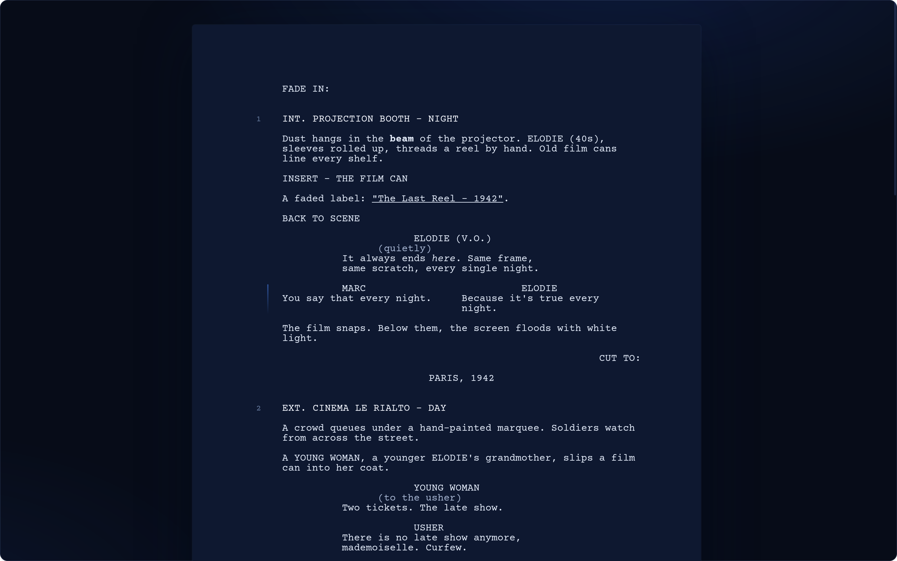

**Zoom** goes from 60% to 200% (`Ctrl+=`, `Ctrl+-`, `Ctrl+0`). Zoom, the navigator's visibility,
autosave, spelling and the export options are remembered between sessions.

## Screenplay elements

| Element | Shortcut | Format |
|---|---|---|
| Scene heading (slugline) | `Ctrl+1` | Capitals, 1.5" from the left edge, numbered |
| Action | `Ctrl+2` | 1.5" from the left edge, full width |
| Character | `Ctrl+3` | Capitals, 3.7" from the left edge |
| Parenthetical | `Ctrl+4` | 3.1" from the left edge, in parentheses, hanging indent |
| Dialogue | `Ctrl+5` | 2.5" from the left edge, 35 characters wide |
| Transition | `Ctrl+6` | Capitals, right-aligned |
| Insert / shot | `Ctrl+7` | Capitals, like a scene heading but not numbered and not a scene |
| Intertitle | `Ctrl+8` | Capitals, centered (title cards such as `PARIS, 1942`) |
| Centered | `Ctrl+9` | Centered text (for example `THE END`) |
| Section | type `# ` | Outline heading (`#`, `##`, `###`…), not printed |
| Synopsis | type `= ` | Summary of a scene or section, not printed |

The element type menu in the header bar lists them all with their shortcuts. Use the arrow
keys and `Enter` to pick one from the keyboard. Sections and synopses are described in
[Outline and notes](#outline-and-notes).

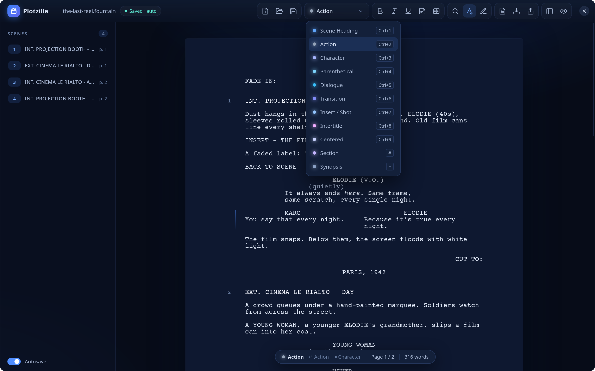

**Dual dialogue** puts two speeches side by side, for characters talking at the same time.
Press `Ctrl+D` (or the columns button) in a dialogue:

- If the next or previous dialogue block is adjacent, the two are placed side by side.
- Otherwise an empty right column opens with a new character cue.
- Inside a dual dialogue, `Ctrl+D` splits it back into two blocks.

In the editor, the columns are drawn side by side, marked by a thin line in the margin.
`Enter` at the end of the left column moves to the right column, and at the end of the right
column it leaves the block.

**Text formatting**: bold, italic and underline (`Ctrl+B`, `Ctrl+I`, `Ctrl+U`) are kept in
Fountain, Final Draft and PDF files. Notes (`Ctrl+Shift+N`) are described in
[Outline and notes](#outline-and-notes).

## Typing a script

Plotzilla follows the Final Draft conventions, so a script can be written without touching the
mouse.

`Enter` at the end of an element creates the element that usually follows it:

| After | `Enter` creates |
|---|---|
| Scene heading | Action |
| Action | Action |
| Character | Dialogue |
| Parenthetical | Dialogue |
| Dialogue | Action |
| Transition | Scene heading |
| Insert, intertitle, centered | Action |
| Section | Scene heading |
| Synopsis | Action |

`Enter` on an **empty** element changes its type instead: an empty action becomes a scene
heading, an empty character or dialogue becomes an action, and an empty parenthetical becomes
dialogue. `Enter` in the middle of an element splits it in two.

`Tab` changes the type of the current element: Action → Character → Transition → Scene heading
→ Action, and Dialogue ⇄ Parenthetical. `Shift+Tab` goes the other way.

`Shift+Enter` adds a line break inside the same element.

Some elements are recognized as you type:

- `INT. `, `EXT. `, `EST. `, `INT./EXT. ` or `I/E ` at the start of an action makes it a scene
  heading.
- `INSERT ` at the start of an action makes it an insert.
- `# ` at the start of an empty action or scene heading makes it a section (`## ` a
  subsection, down to `###### `), and `= ` makes it a synopsis.
- `(` at the start of an empty dialogue opens a parenthetical, with the closing parenthesis
  already in place.
- An all-caps action ending in `TO:` becomes a transition when you press `Enter`.

Changing an element to a parenthetical adds the parentheses; changing it back removes them.
Inside a parenthetical, `Enter` just before the closing parenthesis moves on to the dialogue.

Pasted plain text is read as Fountain, so a script copied from another app or a text file keeps
its scene headings, characters and dialogue.

Undo and redo: `Ctrl+Z`, `Ctrl+Shift+Z` or `Ctrl+Y`.

## Outline and notes

Plotzilla keeps the outline tools of Fountain. None of them is printed; they are saved in
Fountain files, and as script notes in Final Draft files (see [Saving and files](#saving-and-files)).

- **Sections** (`# Act One`, `## The Rialto`) structure the script into acts, sequences or
  any grouping you like. Type `# ` (or `## `, `### `…) at the start of an empty line, or pick
  **Section** in the element type menu. The level shows as `#` marks in the left margin.
- **Synopses** (`= The young woman smuggles the can into the cinema.`) sum up a section or a
  scene. Type `= ` at the start of an empty line, or pick **Synopsis** in the menu.
- **Notes** (`[[Warmer light here?]]`) are remarks inside the text. Press `Ctrl+Shift+N` (or
  the note button) to start or end a note, like bold; select text and press it to turn the
  selection into a note. Notes are shown highlighted in yellow.

The scene navigator shows the sections as headings above their scenes and each synopsis under
the entry it follows, so the navigator reads as an outline. Sections, synopses and notes do not
count in the word count, and a line that only holds a note takes no room on the printed page.

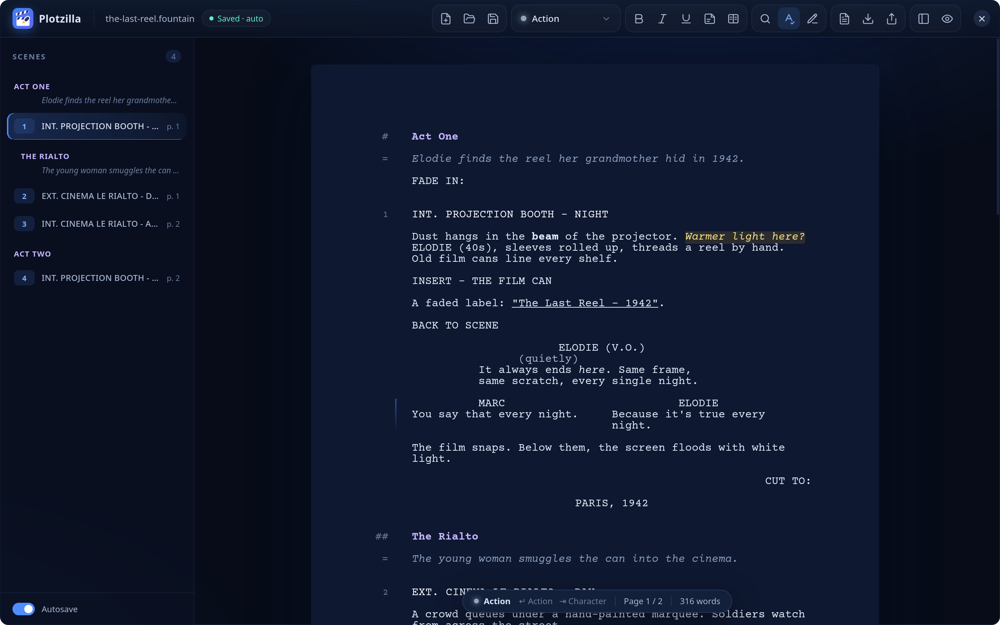

## Autocomplete

Suggestions appear under the cursor while you type. Use `↑` and `↓` to browse, `Enter` or
`Tab` to accept, and `Esc` to dismiss.

- **Character**: names already used in the script, most frequent first. After an opening
  parenthesis: `V.O.`, `O.S.`, `O.C.`, `CONT'D`.
- **Scene heading**: `INT.`, `EXT.`, `INT./EXT.`, `EST.`; then the locations already used; then,
  after ` - `, the time of day (`DAY`, `NIGHT`, `CONTINUOUS`, `LATER`, `MOMENTS LATER`,
  `MORNING`, `EVENING`, `DUSK`, `DAWN`, `SAME`) and any other time used in the script.
- **Insert**: `INSERT -`, `CLOSE ON`, `ANGLE ON`, `POV -`, `WIDE ON`, `EXTREME CLOSE UP ON`,
  `BACK TO SCENE`.
- **Transition**: `CUT TO:`, `FADE OUT.`, `FADE TO:`, `DISSOLVE TO:`, `SMASH CUT TO:`,
  `MATCH CUT TO:`, `JUMP CUT TO:`, `FADE TO BLACK.`

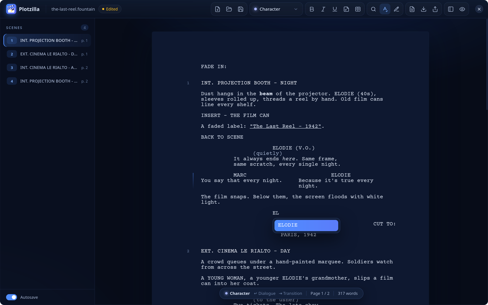

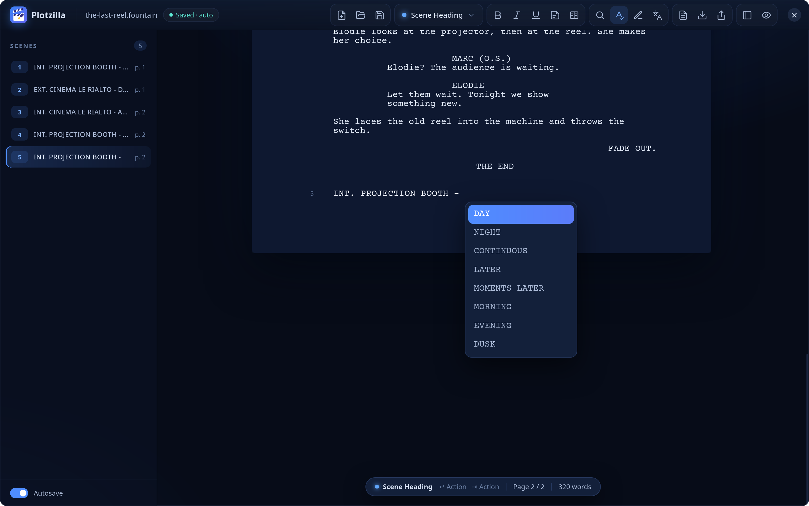

## Find and replace

`Ctrl+F` (or the magnifier button) opens the find bar at the top right of the page. Text
selected in the script is searched right away. Every match is highlighted and the counter shows
which one is selected (`3 of 12`).

- `Enter` and `Shift+Enter` in the find field go to the next and previous match; `F3` and
  `Shift+F3` (or `Ctrl+G` and `Ctrl+Shift+G`) do the same from anywhere. The search wraps around
  the script.
- The two buttons next to the field match the case exactly and match whole words only.
- `Ctrl+H` (or the arrow at the left of the bar) shows the replace field. `Enter` there, or
  **Replace**, replaces the selected match and moves to the next one. **All**
  (`Ctrl+Alt+Enter`) replaces every match at once.
- Replaced text keeps its bold, italic and underline. Each replacement, and a whole
  **Replace all**, is undone in one step with `Ctrl+Z`.
- `Esc` closes the bar and returns to the script.

The search covers the script, not the title page.

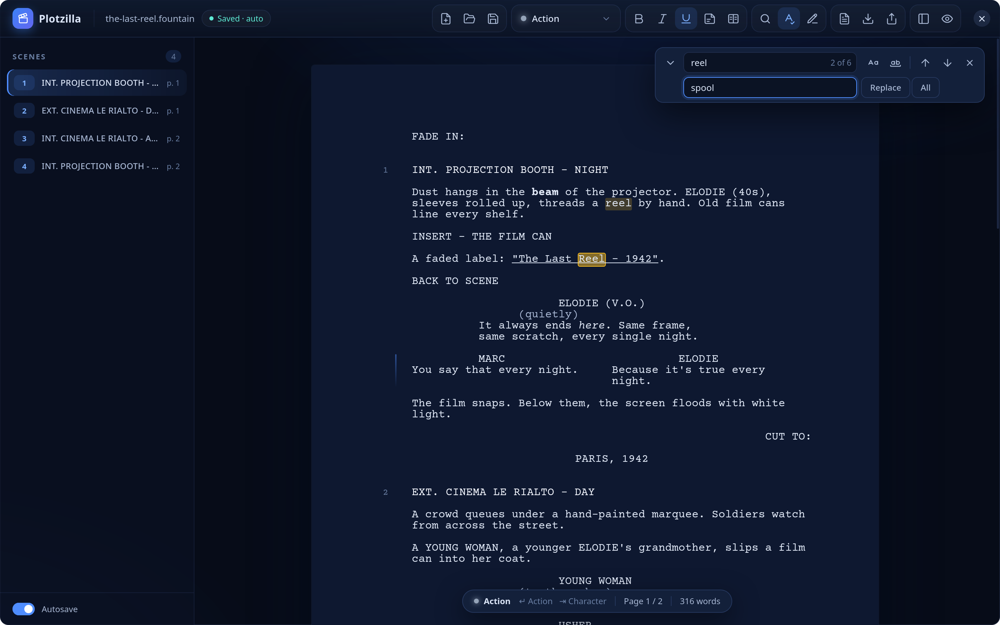

## Spelling

Misspelled words get a wavy red underline, half a second after you stop typing. The word you
are typing is left alone until the cursor leaves it. Right-click an underlined word for:

- corrections, most likely first, in the word's case (`TEH` gives `THE`);
- **Add to Dictionary**: the word is accepted from now on, in every language. The personal
  dictionary is the plain text file `~/.local/share/plotzilla/dictionary.txt`;
- **Ignore All**: the word is accepted until Plotzilla is closed.

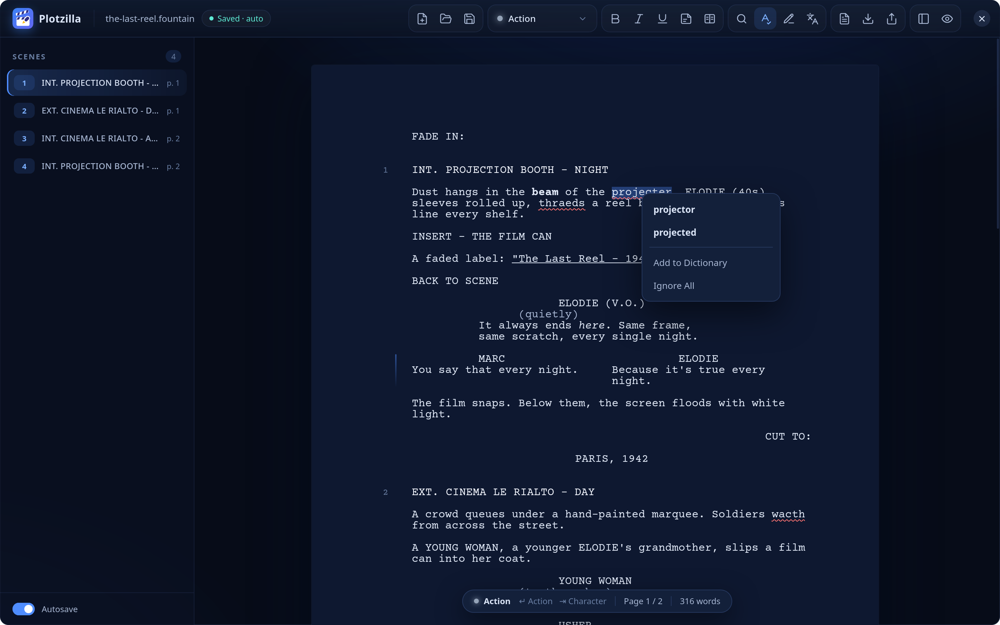

The spelling button in the header bar lists the installed dictionaries. The first time,
Plotzilla picks the one matching the system language. `F7` turns spell checking on and off.

Screenplays are full of names, so:

- Character cues are not checked, and the names they introduce are accepted everywhere,
  possessive included (`ELODIE's`).
- `INT.`, `EXT.`, `EST.` and `I/E` at the start of a scene heading, and common abbreviations
  such as `CONT'D`, `V.O.`, `O.S.` and `POV`, are accepted.
- Words with digits (`3rd`, `R2D2`) and single letters are not checked.

Plotzilla reads Hunspell dictionaries itself (in `$DICPATH`, `~/.local/share/hunspell`,
`/usr/share/hunspell` and `/usr/share/myspell`). It understands prefixes, suffixes, elisions
(`l'homme`), capitalization and compound words: a German, Dutch or Scandinavian compound
missing from the dictionary (`Haustürschlüssel`) is accepted when the dictionary allows its
parts to be joined, including the compound patterns some dictionaries describe with Hunspell's
`COMPOUNDRULE`.

## Translating from French

The translate button in the header bar (`Ctrl+Shift+L`) translates a French script into
English. It runs on your computer, without an internet connection, so a script never leaves it.

- With text selected, the elements the selection touches are translated; otherwise the whole
  script and its title page are (the title itself is kept).
- Text that is already in English is left as it is, so you can translate a script a scene at
  a time, revise the English, and translate the rest later. A translation is undone in one step
  with `Ctrl+Z`.
- A progress window shows the sentences translated so far; **Cancel** stops without changing
  the script.

Each element is translated the way an English script writes it:

| Element | French | English |
|---|---|---|
| Scene heading | `INT. CUISINE DE MARIE - NUIT` | `INT. MARIE'S KITCHEN - NIGHT` |
| | `EXTÉRIEUR RUE - AUBE (FLASH-BACK)` | `EXT. STREET - DAWN (FLASHBACK)` |
| Character | `PIERRE (VOIX OFF)`, `(H.C.)`, `(SUITE)` | `PIERRE (V.O.)`, `(O.S.)`, `(CONT'D)` |
| | `LE POLICIER` | `THE POLICEMAN` |
| Parenthetical | `(un temps)`, `(à voix basse)`, `(à Marie)` | `(beat)`, `(quietly)`, `(to Marie)` |
| Transition | `FONDU ENCHAÎNÉ :`, `COUPE SUR :`, `FONDU AU NOIR.` | `DISSOLVE TO:`, `CUT TO:`, `FADE TO BLACK.` |
| Insert / shot | `GROS PLAN SUR LA LETTRE`, `CONTRECHAMP` | `CLOSE ON THE LETTER`, `REVERSE ANGLE` |
| Action, dialogue | `Marie ? Tu es là ?` | `Marie? Are you there?` |

- Times of day, character extensions, transitions, shots and the usual wrylies come from a
  table of screenplay terms. Locations, action, dialogue, notes, sections and synopses are
  translated by the model, one sentence at a time.
- Character names are kept as they are: `Marie` does not become `Mary`, nor `Pierre` `stone`.
  A cue is translated only when it is a description starting with an article (`LE POLICIER`).
- A French transition or shot typed as action, as in a Fountain file (`FONDU AU NOIR.`,
  `GROS PLAN SUR…`), becomes a transition or an insert.
- English typography replaces French typography: no space before `?`, `!`, `:` or `;`, and
  straight quotes instead of guillemets.
- A sentence is French when its words say so: French words such as `le`, `qui` or `avec`,
  elisions (`l'homme`), accents, and, when the French and English Hunspell dictionaries are
  installed, which of the two languages knows its other words. A line too short to tell
  (`Attends !`, `Oui ?`) follows the elements around it.
- Notes are translated on their own. Bold, italic or underline that covers only part of a
  translated sentence is lost, since the words move; emphasis on a whole sentence is kept.
  Locked pages stay in the same proportion of the translated element, and while revisions are
  marked, translated text is marked with the current revision set.

The model is [OPUS-MT French–English](https://huggingface.co/Helsinki-NLP/opus-mt-fr-en) by the
University of Helsinki (Apache 2.0 license). Plotzilla runs it itself, in Go, with nothing else
to install. The first translation asks to download it (about 300 MB) from Hugging Face into
`~/.local/share/plotzilla/models/opus-mt-fr-en`; every file is checked against its known
checksum, and an interrupted download resumes where it stopped. The model takes about 300 MB of
memory while it is loaded, and is unloaded after five minutes without translating. A machine
translation is a first draft: read it over, especially the dialogue.

## Pages and scenes

Page breaks are computed by the same engine as the PDF export and drawn live in the editor, with
the page number, so the screen always matches the printed script.

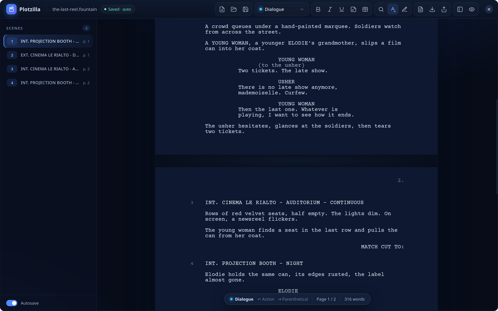

Pagination follows the usual conventions:

- A page holds 54 lines of Courier 12 pt (58 on A4), so one page is about one minute of
  screen time.
- A scene heading or an insert never ends a page.
- Action and dialogue only break at the end of a sentence, with at least two lines on each side.
- A page never ends on a parenthetical.
- Dialogue that continues onto the next page gets `(MORE)` at the bottom and `NAME (CONT'D)` at
  the top of the next page.
- A dual dialogue is never split across pages.
- The title page and page 1 are not numbered.
- Sections, synopses and notes are not printed.

**Forced page breaks**: `Ctrl+Enter` starts a new page at the cursor (Fountain's `===`). In the
middle of an element it splits it, at the end it opens the next element on a new page, and at
the start of an element it puts that element on a new page, or takes it back if it already was.
In a dialogue block or a dual dialogue, the whole block moves to the next page: dialogue is
never split by hand. A forced break is labelled `PAGE BREAK` in the editor, next to the page
number.

Scenes are numbered automatically. Scene numbers written in a Fountain file (`#12A#`) or a Final
Draft file are kept.

## Revisions and locked pages

Once a script is in production, changes are issued as colored revision pages. The revisions
button in the header bar opens the revision menu:

- **Start Revisions** creates the first revision set, **Blue**, dated today, and starts marking
  changes. **New Revision Set** starts the next color, in the industry order: Blue, Pink,
  Yellow, Green, Goldenrod, Buff, Salmon, Cherry, then Double White, Double Blue and so on.
- **Mark Revisions** turns marking on or off. While it is on, everything you type, paste or
  replace is marked with the current set, and a deletion marks the character next to it so the
  line still shows as changed. Undo removes a change and its mark together.
- Revised text is tinted with the color of its set, and the status bar shows the set being
  marked. The menu lists every set with its date.
- **Clear Revision Marks…** turns all revised text back into original text (it can be undone);
  the sets are kept.
- **Lock Pages** fixes every page where it starts now. Material added to a page then flows onto
  A pages (`12A`, `12B`) instead of pushing the following pages, and a page whose material has
  all been removed is merged with the page before it (`12-13`). Each locked page starts on the
  same text however the text around it is edited. Choose **Lock Pages** again to unlock: the
  script is paginated normally, and locking again numbers the pages afresh.

In the PDF, a revised page gets a header naming its revision and date (`Pink Revision -
09/28/26`), and each line changed in that revision an asterisk in the right margin. A page
keeps the color of the latest revision that changed it; its older changes are no longer starred.
The export dialog can leave revision marks out.

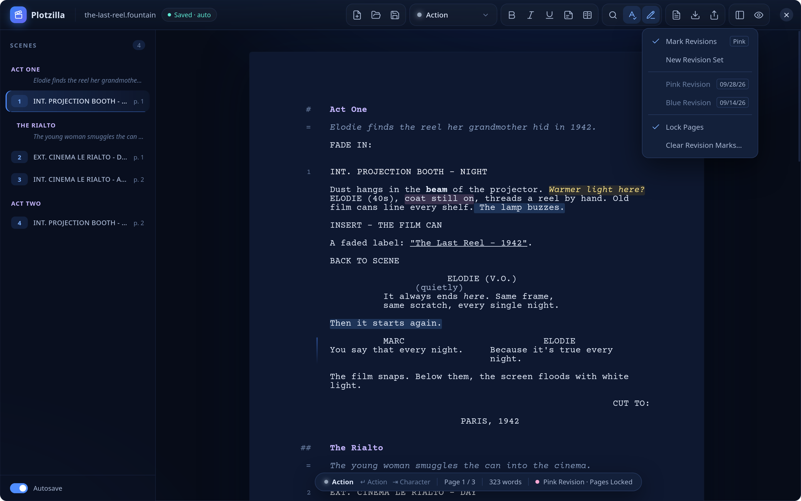

## Title page

`Ctrl+Shift+T` (or the title page button) opens the title page: title, credit ("Written by"),
authors, source ("Based on…"), contact, draft date and notes. On the PDF, the title block is
centered in the upper half, the contact is at the bottom left and the draft date and notes are
at the bottom right.

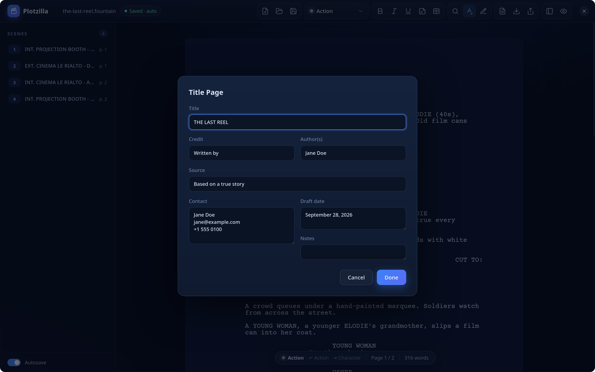

## Saving and files

**Fountain** (`.fountain`) is the native format. It is plain text, readable in any editor, easy
to track with git, and supported by Highland, Fade In, WriterDuet and Arc Studio. Plotzilla also
opens `.spmd` and `.txt` files as Fountain.

**Final Draft** (`.fdx`) files can be opened and saved. Styles, scene numbers, dual dialogue and
forced page breaks are kept. Final Draft stores the title page as free text, so on import
Plotzilla fills the title page fields from how each line is aligned. In Final Draft files:

- notes are script notes at their place in the text;
- sections and synopses, which Final Draft does not have, are script notes starting with `#` or
  `=` at the start of the paragraph that follows them, and are read back as sections and
  synopses;
- revised text keeps its revision set, and the sets are named like `Pink Revision - 09/28/26`
  (a set named by Final Draft, such as `Goldenrod Rev.`, keeps its color);
- locked pages and the paper size are not written: save as Fountain to keep them.

Fountain has no insert or intertitle elements, so Plotzilla writes them the usual way:

- An insert is written as an all-caps line. It is read back as an insert when it starts like
  one (`INSERT`, `CLOSE ON`, `ANGLE ON`, `POV`, `WIDE ON`, `BACK TO SCENE`…). Otherwise it
  comes back as an all-caps action line, which prints the same way.
- An intertitle is written as centered text (`> PARIS, 1942 <`). Any all-caps centered text is
  read back as an intertitle.

In Final Draft, inserts map to the Shot element and intertitles to centered action.

Sections (`#`), synopses (`=`) and notes (`[[…]]`) are read and written as Fountain defines
them. What Fountain has no syntax for is stored in boneyard comments, which other Fountain apps
ignore:

- revised text is wrapped in `/*rev 2*/…/*/rev*/`, where the number is the revision set;
- a locked page starts at `/*page 12*/`;
- the paper size, the revision sets and whether revisions are marked and pages locked are kept
  in one `/* Plotzilla {…} */` line at the end of the file.

A forced page break is written `===` on its own line. A script that uses none of these features
is written exactly as before. Other boneyard comments in a Fountain file are ignored when it is
opened, so they are lost when Plotzilla saves it.

**Autosave** is on by default; turn it off with the switch at the bottom of the scene navigator.
When it is on, Plotzilla saves the script to its file 1.2 seconds after your last keystroke. A
script that has no file yet is backed up to `~/.local/share/plotzilla/recovery.fountain`, and on
the next launch Plotzilla offers to restore it.

Before closing the window, creating a new script or opening another one with unsaved changes,
Plotzilla asks whether to discard them.

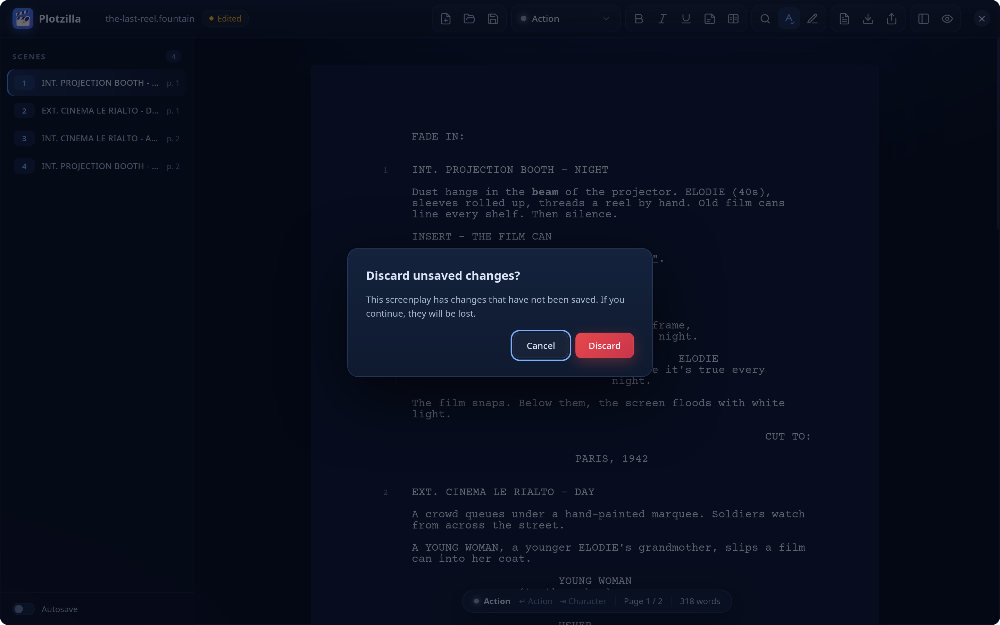

A script can be opened from the command line: `plotzilla path/to/script.fountain`.

## Exporting

**PDF** (`Ctrl+P`): US Letter or A4, Courier 12 pt, 10 characters per inch, 6 lines per inch.
The export dialog can include the title page, print scene numbers in both margins (for a
shooting script) and, when the script has revisions, print the revision headers and asterisks.
The PDF uses the standard Courier fonts built into every PDF reader, and its properties carry
the title and author.

The **paper** size is chosen in the export dialog and saved with the script, because it changes
the pagination: the editor shows the A4 page and its page breaks as soon as it is chosen. A4
keeps the same margins and text widths as US Letter; the longer page holds 58 lines instead of
54.

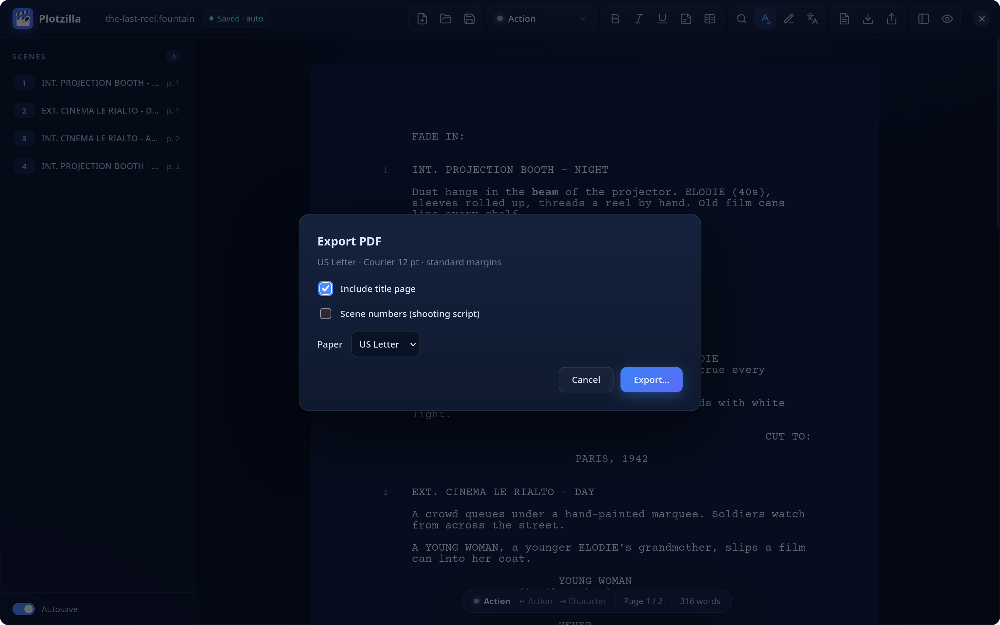

| Element | Position | Width |
|---|---|---|
| Scene heading, action | 1.5" from the left edge | 60 characters |
| Character | 3.7" | 38 characters |
| Parenthetical | 3.1", hanging indent | 25 characters |
| Dialogue | 2.5" | 35 characters |
| Transition | right-aligned at 7.5" | |
| Insert / shot | 1.5", capitals, not numbered | 60 characters |
| Intertitle | centered, capitals | 60 characters |
| Dual dialogue | columns at 1.5" and 4.5" | 27 and 28 characters |

The title page and first pages of a sample script, as exported:

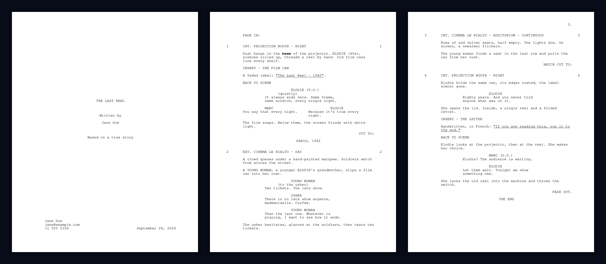

The standard Courier fonts cover Western European characters (accents, curly quotes, dashes).
Other characters, such as Greek, Cyrillic or Asian scripts, are printed as `?`: the export then
warns and lists them, so they are not lost silently.

**Final Draft** (`Ctrl+Shift+E`): writes an `.fdx` file that opens in Final Draft and other apps
that read FDX.

## Keyboard shortcuts

| Keys | Action |
|---|---|
| `Enter` | Next logical element (see [Typing a script](#typing-a-script)) |
| `Shift+Enter` | Line break inside the element |
| `Ctrl+Enter` | Forced page break |
| `Tab` / `Shift+Tab` | Change the element type |
| `Ctrl+1` … `Ctrl+9` | Scene heading, action, character, parenthetical, dialogue, transition, insert, intertitle, centered |
| `Ctrl+D` | Dual dialogue on or off |
| `Ctrl+B` / `Ctrl+I` / `Ctrl+U` | Bold, italic, underline |
| `Ctrl+Shift+N` | Note on or off |
| `# ` / `= ` at the start of an empty line | Section, synopsis |
| `Ctrl+Z` / `Ctrl+Shift+Z` or `Ctrl+Y` | Undo, redo |
| `Ctrl+N` / `Ctrl+O` | New script, open |
| `Ctrl+S` / `Ctrl+Shift+S` | Save, save as |
| `Ctrl+P` / `Ctrl+Shift+E` | Export PDF, export to Final Draft |
| `Ctrl+Shift+T` | Title page |
| `Ctrl+\` | Show or hide the scene navigator |
| `Ctrl+Shift+F` | Focus mode |
| `Ctrl+=` / `Ctrl+-` / `Ctrl+0` | Zoom in, zoom out, reset |
| `↑` / `↓`, `Enter` or `Tab`, `Esc` | Browse, accept or dismiss suggestions |
| `Ctrl+F` / `Ctrl+H` | Find, find and replace |
| `F3` / `Shift+F3`, or `Ctrl+G` / `Ctrl+Shift+G` | Next, previous match |
| `Enter` / `Shift+Enter` in the find field | Next, previous match |
| `Enter` / `Ctrl+Alt+Enter` in the replace field | Replace, replace all |
| `F7` | Spell checking on or off |
| `Ctrl+Shift+L` | Translate the selection, or the whole script, from French to English |

## Desktop integration

- The header bar replaces the system title bar: drag it to move the window and double-click it
  to maximize. The window buttons follow the desktop's button layout, like other GTK
  applications: which buttons appear (only close with GNOME's default layout) and on which side.
- The window has rounded corners, which become square when maximized, or when no compositor
  makes the window transparent (some X11 window managers). The header bar dims when the window
  loses focus.
- The interface is always dark. File choosers follow the desktop's light or dark preference
  (read from the XDG desktop portal, or from GNOME's setting when no portal is running) and
  switch when it changes; without an explicit preference they keep the desktop's GTK theme.
- All text is in English, including the buttons of the system file chooser, whatever the system
  language.

## Development

```sh
make test         # Go tests
PLOTZILLA_MT_MODEL=~/.local/share/plotzilla/models/opus-mt-fr-en go test ./internal/marian
                  # also test the real translation model, once downloaded
make screenshots  # regenerate the images of this README (needs Firefox and pdftoppm)
make dev          # live reload, requires the Wails CLI:
                  # go install github.com/wailsapp/wails/v2/cmd/wails@latest
```

Always build with `make`, or pass `-tags desktop,production,webkit2_41` to `go build`. The Go
binary embeds `frontend/dist`, so the frontend has to be built first.

```
main.go, app.go        Wails application and the methods the frontend calls
translation.go         translation: model download, loading and the Translate method
desktop_linux.go       desktop integration: light/dark preference, window button layout
desktop/               icon, desktop entry and MIME types installed by `make install`
packaging/arch         PKGBUILD for an Arch Linux package
internal/screenplay    document model
internal/fountain      Fountain reader and writer
internal/fdx           Final Draft reader and writer
internal/layout        line wrapping and pagination, shared by the editor and the PDF
internal/pdf           PDF generator with no dependencies
internal/spell         Hunspell dictionary reader and spell checker
internal/marian        MarianMT translation models in pure Go: SentencePiece, transformer,
                       beam search, verified download
internal/translate     French to English script translation, element by element
frontend/src           editor: schema, commands, autocomplete, page breaks, find, spelling,
                       revisions and locked pages, translation, interface
screenshots/           images used in this README
tools/screenshots      the tool behind `make screenshots`
```

Contributor guidelines (architecture, conventions, testing, and Go, TypeScript and CSS
practices) are in [AGENTS.md](AGENTS.md).

## Not supported yet

Locked pages and the paper size in Final Draft files; characters outside Western European
scripts in the PDF.

## License

Plotzilla is free software, released under the GNU General Public License v3.0. See
[LICENSE](LICENSE).

The model downloaded for translation is separate: [OPUS-MT French–English](https://huggingface.co/Helsinki-NLP/opus-mt-fr-en),
by the University of Helsinki, is released under the Apache 2.0 license.
